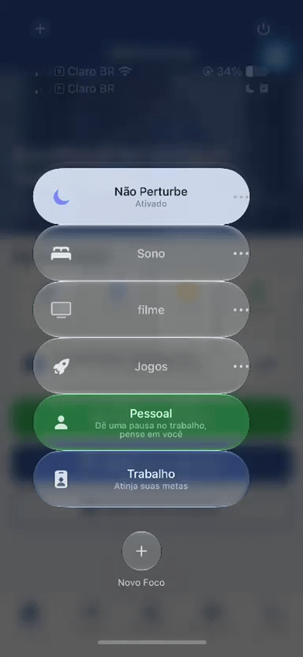
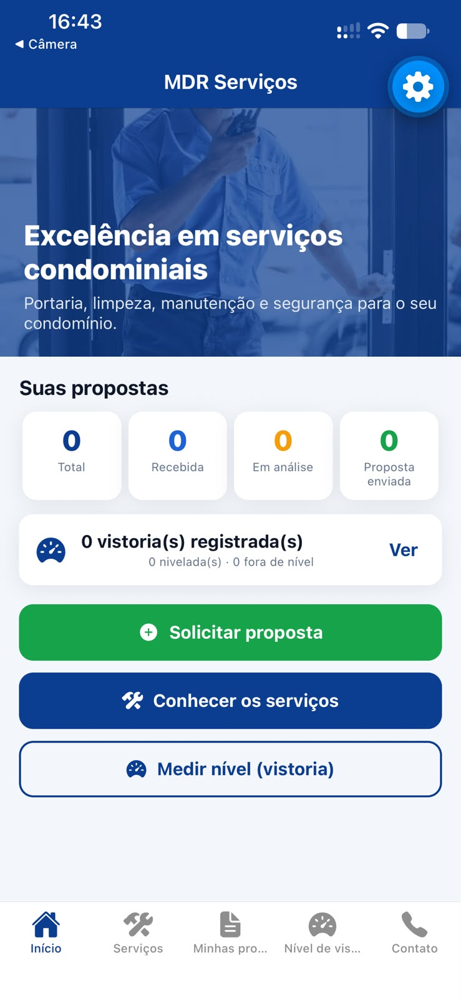
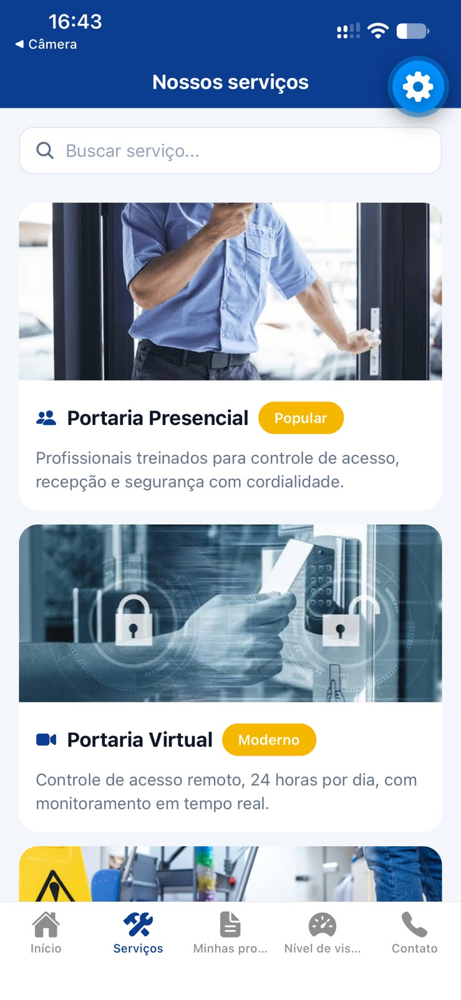
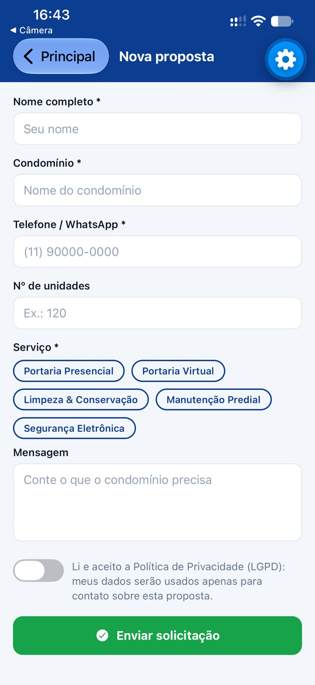
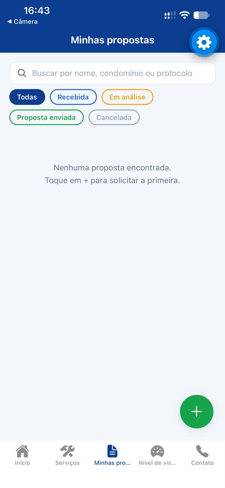
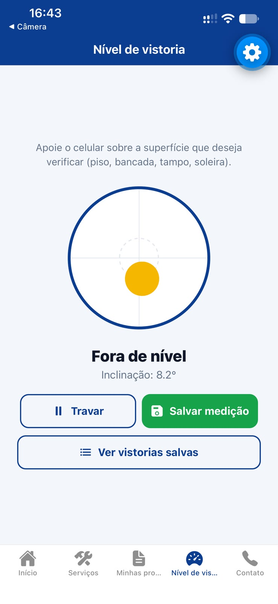
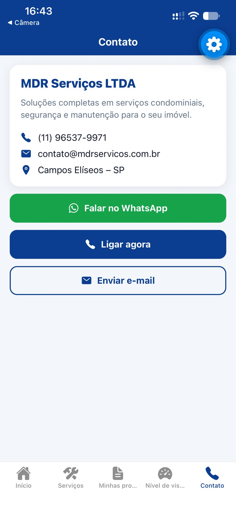

# MDR Serviços – App Móvel (React Native / Expo)

Projeto final da disciplina **CCP150 – Desenvolvimento de Aplicativos Móveis** (FEI – Prof. Vinicius), desenvolvido em grupo.

<p align="center">
  
</p>

---

## 1. Visão Geral e Requisitos

### Tema
App da **MDR Serviços LTDA**, empresa de serviços para condomínios (portaria presencial e virtual, limpeza, manutenção predial e segurança eletrônica). O app é usado pelo **síndico ou administrador** do condomínio.

### Motivação
Hoje a MDR só tem um site institucional, e os pedidos de orçamento chegam por WhatsApp ou telefone, sem registro e sem acompanhamento. Além disso, na visita técnica o técnico costuma conferir o nivelamento de pisos, soleiras e bancadas com um nível de bolha físico, e anota o resultado no papel.

### Objetivo
Levar o catálogo de serviços e todo o ciclo da proposta para o celular:
1. o síndico **solicita uma proposta** e recebe um **protocolo**;
2. **acompanha** o andamento numa linha do tempo de status;
3. **registra vistorias** usando o próprio celular como **nível digital** (acelerômetro), com **foto do local** e observações;
4. **compartilha** o resumo da proposta e entra em **contato** com a empresa com um toque.

### Requisitos do projeto e como foram atendidos

| Requisito | Como foi atendido |
|---|---|
| Mínimo de 6 telas distintas | **10 telas**: Início, Serviços, Detalhe do serviço, Propostas, Nova/Editar proposta, Detalhe da proposta, Vistoria (nível), Registrar/Editar vistoria, Vistorias salvas e Contato. *(não há login/cadastro)* |
| Navegação com React Navigation | **Bottom Tabs** (5 abas) dentro de um **Native Stack** (telas de detalhe e formulários), com passagem de parâmetros e navegação entre abas aninhadas |
| Imagens | Fotos dos serviços (`imagens/`), fundo da tela inicial (`ImageBackground`), **fotos tiradas pela câmera** nas vistorias e ícones Ionicons |
| Interface e UX | Tema centralizado (`theme.js`), componentes reutilizáveis (`ui.js`), espaçamento padrão de 16 px, cards com sombra, cores por status |
| Feedback ao usuário | Validação campo a campo com mensagem de erro, alertas de sucesso/erro, confirmação antes de excluir, "Salvando...", indicador de carregamento, listas vazias com instrução, **vibração** |
| Banco de dados com CRUD completo | **SQLite** (`expo-sqlite`) com **3 tabelas relacionadas** e **dois CRUDs completos** (Propostas e Vistorias) + histórico |
| Sensor ou atuador | **Sensor:** acelerômetro (nível digital) e câmera. **Atuador:** vibração (ao nivelar, nos erros, ao salvar e ao excluir) |

---

## 2. Tecnologias Utilizadas

| Tecnologia | Para que foi usada no app |
|---|---|
| **React Native + Expo** | Base do app; roda no celular pelo Expo Go |
| **JavaScript** | Linguagem do projeto |
| **@react-navigation/native** | `NavigationContainer` e `useFocusEffect`, que recarrega os dados do banco sempre que a tela volta ao foco |
| **@react-navigation/bottom-tabs** | Barra inferior com as 5 abas principais |
| **@react-navigation/native-stack** | Pilha de telas por cima das abas (detalhes e formulários), com cabeçalho e botão voltar |
| **expo-sqlite** | Banco local: criação das tabelas, consultas com parâmetros (`?`, evita SQL injection), `JOIN`, `GROUP BY`, transações (`withTransactionAsync`) e `ON DELETE CASCADE` |
| **expo-sensors** | `Accelerometer`: leitura dos eixos x/y/z a cada 80 ms para o nível digital |
| **expo-image-picker** | Abre a **câmera** ou a **galeria** (com pedido de permissão) para anexar a foto do local da vistoria |
| **expo-file-system** | Copia a foto do cache da câmera para a pasta permanente do app (`Paths.document`) e apaga o arquivo quando a vistoria é excluída |
| **Vibration** (React Native) | Atuador de vibração com padrões diferentes para sucesso, erro e exclusão |
| **Share** (React Native) | Menu nativo de compartilhamento (WhatsApp, e-mail...) com o resumo da proposta |
| **Linking** (React Native) | Abre WhatsApp, discador e e-mail na tela Contato |
| **@expo/vector-icons** | Ícones Ionicons nas abas, botões e cards |
| **react-native-safe-area-context / react-native-screens** | Respeitam o notch e as barras do sistema e otimizam a navegação |

---

## 3. Funcionalidades

### Início
- Banner com imagem e chamada da empresa.
- **Painel** com o total de propostas e a contagem por status (consulta `GROUP BY` no banco).
- Card com a quantidade de vistorias registradas (niveladas × fora de nível).
- Atalhos para solicitar proposta, ver serviços e medir nível.

### Serviços e Detalhe do serviço
- Catálogo dos 5 serviços com foto, ícone, selo ("Popular", "Moderno") e **busca por texto**.
- O detalhe mostra a foto grande e a descrição, além de um botão que abre o formulário **já com o serviço selecionado**.

### Propostas: CRUD completo
- **Create:** formulário com validação, **máscara de telefone**, escolha do serviço, **aceite da LGPD** e geração do **protocolo `MDR-ANO-0001`**. A criação grava a proposta e o primeiro evento do histórico **na mesma transação**.
- **Proteção contra duplicidade:** não deixa haver duas propostas ativas com o mesmo telefone, condomínio e serviço. Vale na criação e na edição.
- **Read:** lista com **busca** (nome, condomínio ou protocolo), **filtro por status** e quantidade de vistorias de cada proposta.
- **Update:** edição dos dados do cliente.
- **Delete:** com confirmação e vibração. Apaga em cascata o histórico, as vistorias e os **arquivos das fotos**.

### Detalhe da proposta
- Dados completos e botões de editar e **compartilhar** (menu nativo).
- **Linha do tempo** com cada mudança de status, data, hora e observação (tabela `historico`).
- Lista das vistorias daquela proposta e botão "Medir e registrar vistoria".
- O cliente pode **cancelar ou reabrir** a solicitação.
- **Área da equipe MDR (simulação):** representa o lado da empresa, que atualiza o status (Recebida → Em análise → Proposta enviada) com observação. O cliente vê a atualização na linha do tempo.

### Vistoria: nível digital (sensor + atuador)
- Bolha que se move conforme o **acelerômetro** e mostra a inclinação em graus (`atan2`).
- **Vibra** ao atingir o nível. A **histerese** (entra em 0,04 g, sai em 0,06 g) evita que o celular vibre sem parar por causa do ruído do sensor.
- Botões para **travar** a medição e **salvar** a medição.

### Vistorias: 2º CRUD completo
- **Create:** recebe a inclinação medida e pede a proposta, o ambiente (atalhos ou texto livre), a **foto pela câmera ou galeria** e observações.
- **Read:** tela "Vistorias salvas" com filtro *Todas / Niveladas / Fora de nível*, e também dentro do detalhe da proposta.
- **Update:** troca de ambiente, foto, observação ou proposta.
- **Delete:** com confirmação. Remove também a foto do aparelho.

### Contato
- Dados da empresa e botões para **WhatsApp**, **ligação** e **e-mail** (`Linking`).

### Modelo do banco de dados

```
propostas (1) ──< historico (N)     id, propostaId, status, observacao, data
    │
    └───────< vistorias (N)          id, propostaId, ambiente, inclinacao, nivelado, foto, observacao, criadoEm, atualizadoEm

propostas: id, protocolo, nome, condominio, telefone, unidades, servico, mensagem, status, criadoEm, atualizadoEm
```

### Estrutura de pastas

```
App.js                    → navegação (Stack + Tabs)
src/theme.js              → cores, status e sombra
src/ui.js                 → componentes reutilizáveis (Botao, Campo, Chip, CartaoVistoria)
src/util.js               → formatação de data e gravação/remoção de fotos
src/db/database.js        → banco SQLite (tabelas e todas as funções do CRUD)
src/data/servicos.js      → catálogo de serviços
src/screens/              → as 10 telas
imagens/                  → fotos dos serviços
docs/                     → prints e gif usados neste README
```

---

## 4. Demonstração

| Início | Serviços | Nova proposta |
|:---:|:---:|:---:|
|  |  |  |

| Propostas | Vistoria (nível) | Contato |
|:---:|:---:|:---:|
|  |  |  |

---

## 5. Instalação e Execução

**Pré-requisitos:** [Node.js](https://nodejs.org) 20 ou mais recente e o app **Expo Go** no celular (Android ou iOS).

```bash
# 1. Clonar o repositório
git clone https://github.com/SEU-USUARIO/mdr-app.git
cd mdr-app

# 2. Instalar as dependências
npm install

# 3. Iniciar o servidor do Expo
npx expo start
```

4. Escaneie o QR Code com o **Expo Go** (no Android) ou com a **câmera** (no iOS). O celular e o computador precisam estar na mesma rede Wi-Fi. Se não estiverem, use `npx expo start --tunnel`.

> O acelerômetro, a vibração e a câmera só funcionam em **celular físico**. No emulador, a tela de vistoria mostra o aviso "Acelerômetro indisponível".

---

## 6. Aprendizados e Próximos Passos

### Aprendizados
- **Navegação aninhada:** colocar as abas dentro de uma pilha e navegar de uma tela da pilha para uma aba específica (`navigate('Principal', { screen: 'Vistoria', params })`).
- **Banco relacional no celular:** chave estrangeira com `ON DELETE CASCADE`, `JOIN`, subconsulta e `GROUP BY`. Também aprendemos a usar **transações** para que o protocolo e o histórico nunca fiquem pela metade.
- **Sensores na prática:** a leitura do acelerômetro tem ruído, e foi preciso aplicar **histerese** para o feedback (cor e vibração) não ficar "piscando". Também aprendemos a assinar o sensor só com a tela em foco, para economizar bateria.
- **Arquivos e permissões:** a foto da câmera fica num cache temporário, então é preciso copiá-la para uma pasta permanente e apagá-la junto com o registro.
- **UX:** validação por campo, confirmações antes de ações destrutivas, estados vazios e de carregamento.

Todo o grupo participou da montagem do projeto, e os labs realizados durante as aulas ajudaram muito a todos a montar o projeto da maneira mais íntegra possível. Já tínhamos trabalhado com a MDR no projeto de Engenharia de Software e Ecologia, que consistiu em criar um site para computador para a empresa. Porém, nada se comparou a criar um aplicativo para celular: foi algo muito dinâmico, que nos fez pensar e aprender muito.

### Próximos passos
- Sincronizar os dados com a nuvem (Firebase/Firestore) para a equipe da MDR atender pelo próprio painel.
- Login com perfis separados de **cliente** e **equipe**, substituindo a "Área da equipe MDR" simulada.
- Notificações push quando o status mudar.
- Gerar um **relatório em PDF** da vistoria com fotos e medições.
- Calibração do nível digital (zerar em uma superfície de referência).

---

## 7. Uso de IA

Seguindo o guia de ética da disciplina: o grupo usou IA (Claude) como apoio para **revisar o código, sugerir melhorias de UX e de organização das telas e identificar erros**. Todo o código foi lido, adaptado e testado pelo grupo no celular, e todos os integrantes conseguem explicar cada parte na apresentação.

## 8. Créditos

- Textos dos serviços: site institucional da MDR Serviços LTDA.
- Imagens em `imagens/`: site institucional da MDR Serviços LTDA.
- Ícones: [Ionicons](https://ionic.io/ionicons) (licença MIT) via `@expo/vector-icons`.
